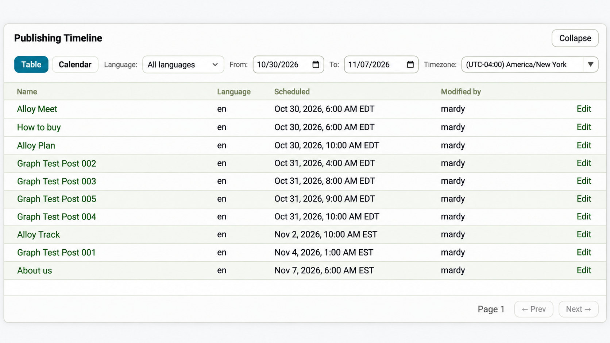
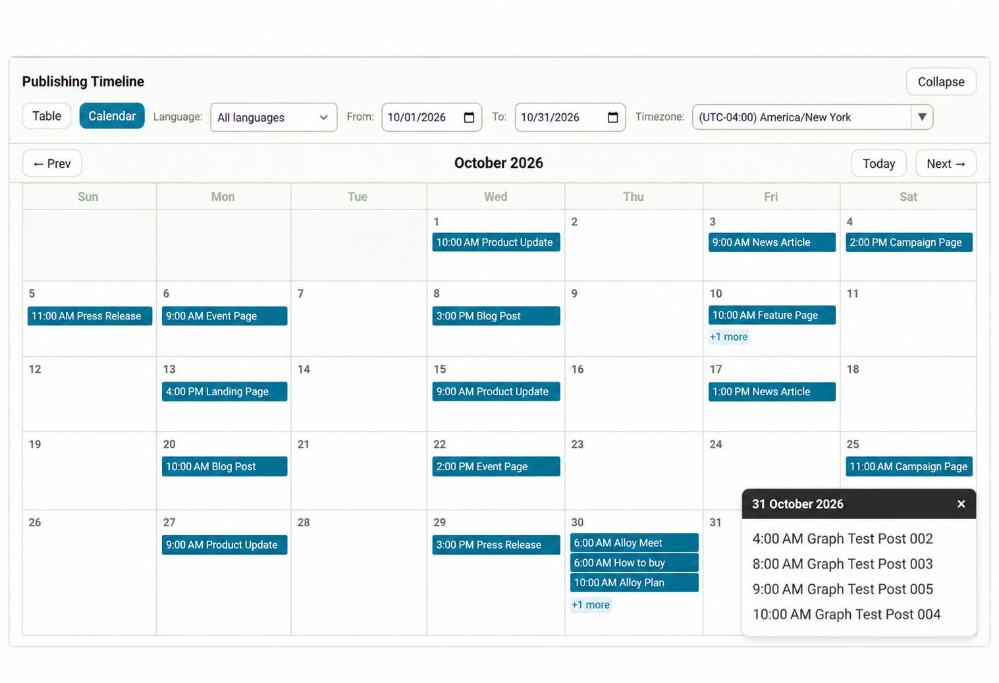

# Publishing Timeline for Optimizely CMS 13

**Publishing Timeline** is a free, open-source add-on for Optimizely CMS 13 that gives content editors a clearer overview of what's scheduled to go live and when.

The native CMS Dashboard includes a **Scheduled** tab within the **Workflow Status** gadget, but it provides limited information about upcoming publications. It doesn't offer a dedicated calendar view or flexible ways to explore publishing schedules.

Publishing Timeline extends this experience with **table and calendar views, language and date filters, and timezone switching**, making it easier to review and plan upcoming content releases.

**Current release:** [v1.0.0](https://github.com/mardy-awd/Optimizely.PublishingTimeline/releases/tag/v1.0.0)

**NuGet package:** [Mardy.Optimizely.PublishingTimeline](https://nuget.optimizely.com/packages/mardy.optimizely.publishingtimeline/1.0.0)

For an introduction with screenshots and examples, see the [Publishing Timeline article on Optimizely World](https://world.optimizely.com/blogs/mardy-abdelkareem/dates/2026/10/introducing-publishing-timeline-for-optimizely-cms-13/).

## Screenshots

### Table view

Browse scheduled publications with content names, languages, publishing dates, the user who last modified each version, and direct links to the CMS editor.



### Calendar view

Explore upcoming publications in a monthly calendar. When multiple items are scheduled for the same day, the **+N more** option opens a popup showing additional publications and their scheduled times.



## Features

- **Table view:** Browse scheduled publications with content names, languages, publishing dates, a **Modified by** column showing the user who last modified each version, and pagination.
- **Calendar view:** Visualize upcoming publications in a monthly calendar, with quick access to scheduled content.
- **Timezone switching:** View scheduled publishing times in different timezones without changing the actual publication schedule.
- **Language filtering:** Focus on content scheduled for a specific language.
- **Date filtering:** Narrow the schedule to a selected date range. From and To dates cover whole days in the selected timezone, including daylight saving time transitions.
- **Shared filters:** Language, date, and timezone filters apply to both views. Switching between Table and Calendar always shows results for the current filters.
- **Quick access:** Open scheduled content directly in the CMS editor.
- **Flexible layout:** Expand, collapse, or resize the timeline within the Dashboard.
- **Permission-aware results:** Scheduled content is subject to the current user's CMS access permissions.
- **Zero-configuration installation:** Install the NuGet package without modifying your application's startup or endpoint configuration.

## Publishing across markets

For global content teams, understanding when content will go live in different markets is especially important.

Imagine a product launch coordinated across Cairo, London, and New York.

An editor in Cairo can switch the timeline to **New York time** to review publication times for the US market, then switch to **London time** to check the UK schedule.

The scheduled publication time itself remains unchanged. Only its displayed time is converted to the selected timezone.

This makes it easier to:

- Review publishing schedules across different timezones.
- Understand when content will go live in each market's local time.
- Visually identify publications scheduled outside business hours.
- Notice releases scheduled close together.

The add-on provides visibility into these schedules. It does not currently generate automatic business-hours warnings or detect scheduling conflicts.

> **Note:** Timezone switching changes how publishing times are displayed. It does not automatically filter content by market or website. Language and date filters are available separately.

## How it works

Publishing Timeline appears below the native CMS Dashboard when the **Scheduled** tab of the **Workflow Status** gadget is selected.

Editors can switch between two views:

**Table view** provides a structured list of scheduled publications, including content names, languages, scheduled publishing times, and a **Modified by** column with the user who last modified each version. Content names link directly to the CMS editor.

**Calendar view** provides a monthly overview of upcoming publications, making it easier to see how publishing activity is distributed across different days. Editors can open scheduled content directly from calendar events.

Both views display scheduled publishing times using the selected timezone and share the same language and date filters. Filter changes made in one view are reflected when switching to the other.

The timeline can be collapsed, expanded, or resized without affecting the native Dashboard.

Publishing Timeline uses the CMS's existing scheduled publication information. It does not replace or modify the native scheduling and publishing functionality.

## Compatibility

- **Optimizely CMS:** 13.4.0 or later, below 14.0.0
- **.NET:** 10

CMS 13.4.0 is the minimum supported dependency version. Earlier CMS 13 releases may resolve dependencies with known security advisories, including older versions of SixLabors.ImageSharp.

### Verification status

- **CMS 13.5.0:** Runtime integration-tested. The NuGet package was installed in a clean CMS application, and the Alloy sample was tested with a project reference. Dashboard integration, API endpoints, table and calendar views, timezone handling, and sub-path hosting were verified.
- **CMS 13.4.0:** Runtime-tested with the NuGet package. Dashboard integration and table and calendar behavior were verified, including a CMS 13.4-specific link text-color fix.
- **Published package:** Version 1.0.0 was installed successfully from the Optimizely NuGet feed.

Additional CMS 13.x releases have not yet been individually verified.

## Installation

Publishing Timeline v1.0.0 is available on the [Optimizely NuGet feed](https://nuget.optimizely.com/packages/mardy.optimizely.publishingtimeline/1.0.0).

The NuGet package source is:

`https://api.nuget.optimizely.com/v3/index.json`

Install the package using Visual Studio's NuGet Package Manager or the .NET CLI:

```bash
dotnet add package Mardy.Optimizely.PublishingTimeline --version 1.0.0
```

Make sure the Optimizely NuGet feed is configured as a package source.

No additional application configuration is required beyond the standard Optimizely CMS setup.

You don't need to modify `Program.cs` or `Startup.cs`. The add-on registers its services, API endpoints, and Dashboard integration automatically, using the standard Optimizely CMS endpoint setup:

```csharp
endpoints.MapContent();
```

Applications hosted under a sub-path (`PathBase`) are also supported.

After installation:

1. Build and run your CMS application.
2. Open the CMS Dashboard.
3. Navigate to **Workflow Status → Scheduled**.

The Publishing Timeline panel appears below the native Dashboard while the **Scheduled** tab is selected and hides when switching to other tabs.

The native Workflow Status gadget remains unchanged.

The panel and its API are available to users with CMS editing access. Scheduled content is filtered according to the current user's permissions.

## Development

Clone the repository and restore its dependencies.

The repository includes a `NuGet.Config` with the required package sources, including the Optimizely NuGet feed:

`https://api.nuget.optimizely.com/v3/index.json`

### Build

```bash
dotnet restore
dotnet build -c Release
```

### Run tests

Run the C# unit tests:

```bash
dotnet test -c Release
```

Run the JavaScript tests using Node.js:

```bash
node --test "tests/*.test.js"
```

The automated tests cover server-side scheduled-publication filtering, timezone and daylight saving time boundaries, calendar pagination behavior, and keeping the table in sync with filters changed in the calendar.

### Create the NuGet package

```bash
dotnet pack src/Mardy.Optimizely.PublishingTimeline/Mardy.Optimizely.PublishingTimeline.csproj -c Release -o ./artifacts
```

The package includes the add-on assembly, JavaScript and CSS assets, and the README. A symbols package (`.snupkg`) is also generated for debugging.

### Continuous integration

GitHub Actions automatically builds the project, runs the C# and JavaScript tests, validates the NuGet package contents, and uploads the generated packages as workflow artifacts.

The CI workflow runs on pushes to `main` and feature branches, as well as pull requests targeting `main`.

**CI does not publish packages.** Releases are published manually to the Optimizely NuGet feed.

## Known limitations

- The add-on currently supports Optimizely CMS 13 only.
- The calendar retrieves scheduled publications in batches, with a maximum of 1,000 items per calendar load. A notice appears if the result is truncated.
- The Dashboard integration relies on parts of the CMS Dashboard structure that may change in future CMS releases. Compatibility should be verified when upgrading CMS.
- Publishing Timeline is a read-only planning and visibility tool. It does not create, modify, or cancel scheduled publications.
- It does not currently provide automatic scheduling-conflict detection or business-hours warnings.

## Roadmap

- Verify new CMS 13.x releases as they become available.
- Expand functional and edge-case testing.
- Improve compatibility with future CMS updates.

## License

This project is licensed under the [MIT License](LICENSE).

Publishing Timeline is an independent community project and is not affiliated with or officially supported by Optimizely.